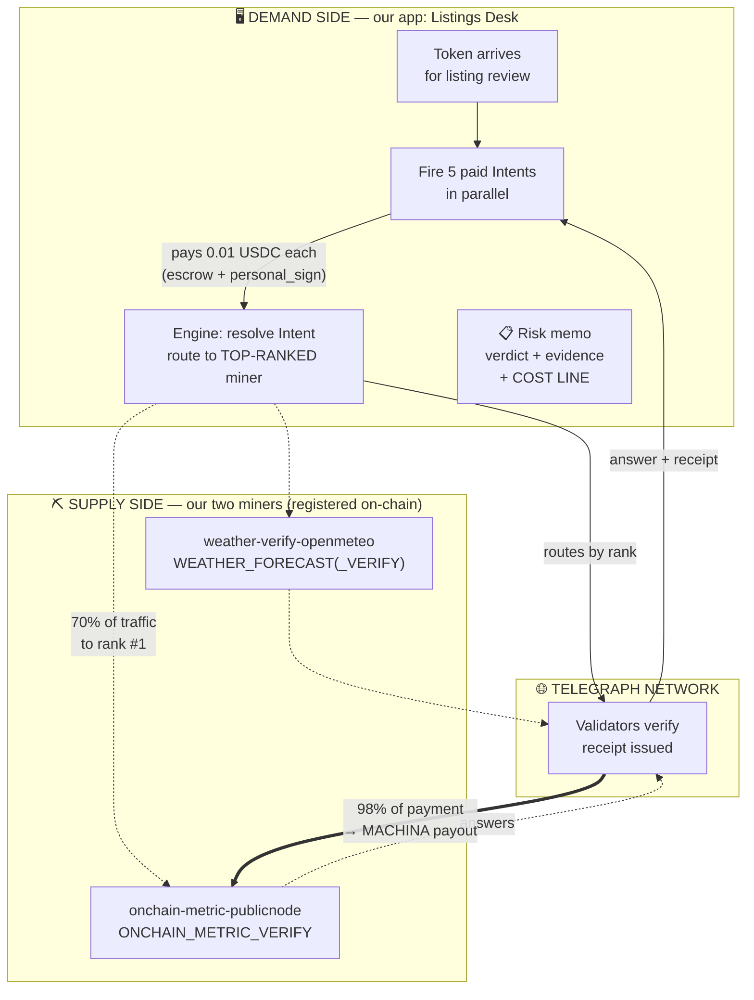

# 🎯 OVERVIEW — Telegraph Listings Desk

> **One-liner:** an autonomous exchange-listings desk that buys verified intelligence with real money through the Telegraph network and produces a signed risk memo — with receipts and a cost line — in about 90 seconds.

---

## The problem

Exchange listing reviews take **weeks of analyst time**. Surveillance is bought **per seat** from a single in-house model. Counterparty checks mean **exposing your book**. And autonomous agents can't trust raw API responses at all — there's no way to verify who answered or how well they've performed historically.

## What we built

**The Listings Desk** — an app for the **Mission 01 (Exchange)** track of Telegraph Hackathon Season II:

1. A token listing candidate arrives.
2. The desk fires **five parallel paid requests** through the Telegraph Engine — `SMART_CONTRACT_AUDIT`, `ONCHAIN_METRIC_VERIFY`, `SANCTIONS_SCREENING_MATCH`, `SOCIAL_BOT_DETECTION`, `CODE_REVIEW`.
3. Telegraph routes each request to the **best-ranked miner** for that Intent (we never hardcode providers).
4. Every answer arrives with a **receipt**: serving miner, cost, latency, `signal_hash`, settlement proof.
5. The desk combines everything into a **listing risk memo**: verdict (GO / REVIEW / NO-GO), evidence lines, a verification hash — and a **cost line** at the bottom.

## How both sides work (and we operate both)

**Supply side (Miner track):** we wrapped two free, keyless APIs as YAML-configured miners and registered them on-chain (Base Sepolia). They're **live in the routing pool** today, earning from real demand:

| Miner | Intent | Missions it enables |
|---|---|---|
| `onchain-metric-publicnode` (ID 9602) | `ONCHAIN_METRIC_VERIFY` | 01 Exchange · 02 Stablecoin · 05 Conflict Intel · 07 Consumer Platform |
| `weather-verify-openmeteo` (ID 9603) | `WEATHER_FORECAST` + `_VERIFY` | 05 Conflict Intel · 06 Resources · 13 Asset Mgmt · 14 Web3 |

**Demand side (Apps & Agents track):** the desk is the consumer. It has already made **real purchases with settlement receipts** on the live testnet — including buying from our own miners, which proves the full supply→demand loop the delivery awards measure.

## Why it's credible — proof, not a pitch

| Claim | Evidence (working links) |
|---|---|
| Miners are registered and live | [Live network catalogue](https://devnode.telegraphprotocol.com/api/miners) — Ctrl+F `publicnode` / `openmeteo` |
| Registration transactions on-chain | [sepolia.basescan.org — our wallet](https://sepolia.basescan.org/address/0x5549286a1C71893816899BbEF8F4CE4d91f87821) (7 txs incl. 2 `registerMiner`) |
| Intelligence was purchased | [Memo with real receipts + cost line](real-run-memos/) · signal hashes verifiable at `GET devnode.telegraphprotocol.com/engine/v1/signal/{hash}` |
| Payment rail works | Settlement receipts (rail: escrow, epoch 440) captured per purchase |
| Reproducible | `npm run demo` (offline) · `node src/cli.mjs <token> --mode real` (live) |

> 🔗 **Repo:** [`github.com/MaahinVPanchal/telegraph-hackathon-s2`](https://github.com/MaahinVPanchal/telegraph-hackathon-s2) — goes public on submission day. Miner YAMLs: [`telegraph-miner-yaml`](https://github.com/MaahinVPanchal/telegraph-miner-yaml).

## The five commercial questions (submission item #5)

- **Who is it for?** Exchange listing/compliance desks — and any agent that needs trustworthy answers before committing money.
- **What does it improve?** Listing review from weeks of analyst time to ~90 seconds of bought, verified intelligence — with per-item cost instead of per-seat licensing.
- **What works today?** Live purchases on testnet: 4 settled buys across 4 Intents, each with receipts; 2 registered miners serving traffic; spending caps enforced.
- **Why would someone adopt it?** Receipts on every input, pay-per-request economics, and routing that automatically improves as miners compete.
- **How to try it?** Clone the repo → `npm install` (nothing to install — zero deps) → `npm run demo` for the full offline pipeline → add a funded wallet for live purchases.

## What to showcase (checklist)

1. **The memo** (`build/milestones/real-run-memos/…html` opened in a browser) — receipts table + cost line.
2. **Live catalogue** — your miners in the network's own list.
3. **Basescan** — the 7 on-chain transactions.
4. **Explorer** — miner pages on `explorer.telegraphprotocol.com`.
5. **Live run** — typing the command and watching the memo generate (record this).
6. **Leaderboard** — `node build/check-leaderboard.mjs` showing our position vs the field.
